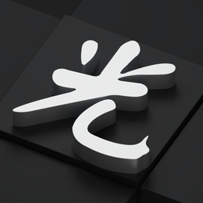

<h1> MuTracer</h1>

[](https://www.npmjs.com/package/@meimu/mutracer)
[](./LICENSE)

**MuTracer** is a physically based path tracer for the web.
It renders on WebGPU and falls back to WebGL 2, with OpenPBR materials,
TinyBVH acceleration and denoising built in.

Try the
[viewer](https://mutracer.meimu-studio.com/viewer/). MuTracer is a 0.x library;
APIs may change between minor releases.

- **WebGPU first, WebGL 2 as fallback**: unidirectional progressive path
  tracing with next-event estimation and multiple importance sampling over
  rect, sphere, spot (with IES profiles), directional and HDR environment
  lights. Without WebGPU, the same code renders on WebGL 2.
- **OpenPBR 1.1 surface**: F82 metals, anisotropic GGX specular and coat,
  fuzz, thin-film interference, dispersive transmission with absorption and
  volume scattering, subsurface scattering, emission and ray-marched
  height-field displacement.
- **Interactive with millions of triangles**: a two-level BVH whose BLASes are
  built with binned SAH in parallel Workers (a JavaScript port of TinyBVH, or
  the TinyBVH WebAssembly builder with SBVH and CWBVH layouts). Moving
  instances only refits the TLAS. See [performance](#performance).
- **Low-noise sampling and denoising**: Owen-scrambled Sobol or blue-noise
  ZSobol sequences. Albedo- and normal-guided denoising with Intel Open Image
  Denoise (WebGPU) or a joint non-local means filter (WebGPU and WebGL 2),
  while the image converges or on the final frame.
- **Incremental Three.js sync**: `THREESync` converts standard and physical
  materials, lights, instancing, skinning and morph targets, and picks up
  transform, material and light edits on every update without reconverting
  the scene.
- **Offline-quality output**: deterministic `converge()` with variance-driven
  adaptive sampling (WebGPU); AgX, ACES, Cineon, Reinhard and linear tone
  mapping, color grading, bloom, thin-lens depth of field, shadow catchers and
  transparent backgrounds.

## Gallery

Rendered live in the browser. Click an image to open the scene in the viewer.

<table>
  <tr>
    <td width="33%"><a href="https://mutracer.meimu-studio.com/viewer/#model=yamaha-mt-09"></a><br /><sub>Yamaha MT-09 · metal and coat · <a href="https://sketchfab.com/3d-models/2025-yamaha-mt-09-sp-v4-cb5878baf5974167806eb8524d57f0b0">VTX</a>, CC-BY-NC-SA 4.0</sub></td>
    <td width="33%"><a href="https://mutracer.meimu-studio.com/viewer/#model=super-human"></a><br /><sub>Super Human · subsurface skin · <a href="https://sketchfab.com/3d-models/super-human-7aa58e978b9f4357b8e73d8e0440c896">Davyd Vidiger</a>, CC-BY 4.0</sub></td>
    <td width="33%"><a href="https://mutracer.meimu-studio.com/viewer/#model=gelatinous-cube"></a><br /><sub>Gelatinous Cube · transmission · <a href="https://sketchfab.com/3d-models/gelatinous-cube-e08385238f4d4b59b012233a9fbdca21">glenatron</a>, CC-BY-NC 4.0</sub></td>
  </tr>
  <tr>
    <td width="33%"><a href="https://mutracer.meimu-studio.com/viewer/#model=dragon"></a><br /><sub>Dragon · glass · <a href="https://benedikt-bitterli.me/resources/">Delatronic</a>, CC-BY 3.0</sub></td>
    <td width="33%"><a href="https://mutracer.meimu-studio.com/viewer/#model=blender-cover-remix"></a><br /><sub>Blender Cover Remix · characters · <a href="https://sketchfab.com/3d-models/blender-cover-remix-a38f11890ff141c88fcdac6b637fdaf8">bandinopla</a>, CC-BY 4.0</sub></td>
    <td width="33%"><a href="https://mutracer.meimu-studio.com/viewer/#model=spheres"></a><br /><sub>Material spheres · OpenPBR layers · procedural, CC0</sub></td>
  </tr>
</table>

## Performance

<a href="https://mutracer.meimu-studio.com/viewer/#model=bugatti-chiron"></a>

The [LEGO Technic Bugatti Chiron](https://mutracer.meimu-studio.com/viewer/#model=bugatti-chiron)
(<a href="https://sketchfab.com/3d-models/lego-technic-bugatti-chiron-c2a54e2e979a4905b859c1533b498221">VTX</a>, CC-BY-NC-SA 4.0)
is a heavy scene that path traces interactively in the viewer:

| | Bugatti Chiron |
| --- | --- |
| Rendered triangles | 4.6 M (2.5 M unique, 341 geometries in 560 meshes) |
| Materials | 35 |
| Download | 12.8 MB `.glb` |
| BVH build, 1 thread | 1.7 s (built-in builder) / 1.0 s (TinyBVH WebAssembly) |
| BVH build, 4 workers (default) | 0.50 s (built-in builder) / 0.28 s (TinyBVH WebAssembly) |
| 1920 × 1080, 64 spp | 12.1 s path tracing, 12.4 s with OIDN denoising |

Measured on an Apple M4 Max: rendering in Chrome with WebGPU at the viewer's
default settings (6 bounces), BVH builds on CPU threads excluding worker startup.

## Install

```bash
npm install @meimu/mutracer
```

Install `three` to load glTF with `GLTFLoader` + `THREESync` or to use
the Three.js helpers. The quick start below also uses `gl-matrix` for matrix math.

The package is ESM with TypeScript declarations (`lib/main.js`). A UMD build
with a `MuTracer` global is at `dist/mutracer.umd.js`; deploy its `dist/assets/`
alongside it. See [loading and deployment](./docs/getting-started.md#loading-and-deployment).

## Quick start

### With Three.js

Build or load a Three.js scene as usual and let `THREESync` keep MuTracer in
sync with it. `RenderLoop` renders progressively and calls the sync each frame.

```ts
import * as THREE from 'three';
import { GLTFLoader } from 'three/examples/jsm/loaders/GLTFLoader.js';
import { OrbitControls } from 'three/examples/jsm/controls/OrbitControls.js';
import { Engine, RenderLoop, THREESync } from '@meimu/mutracer';

const canvas = document.querySelector('canvas')!;

const scene = new THREE.Scene();
scene.add((await new GLTFLoader().loadAsync('model.glb')).scene);

const camera = new THREE.PerspectiveCamera(40, canvas.width / canvas.height, .1, 100);
camera.position.set(0, 2, 6);
const controls = new OrbitControls(camera, canvas);

const engine = new Engine({ canvas });
const sync = new THREESync(engine, { scene, camera, controls });
const loop = new RenderLoop(engine, { sync });
loop.start();
```

Custom Three.js materials and lights can use `convertMaterial` / `convertLight`
in the same sync options; see [Three.js integration](./docs/threejs.md).

### With MuTracer scene classes

Describe meshes, materials, lights and the camera directly with MuTracer.

```ts
import { mat4 } from 'gl-matrix';
import {
  Camera, EnvironmentLight, Mesh, OpenPBRMaterial, RectLight, Engine, RenderLoop,
  Texture, createPlaneGeometry, createSphereGeometry, type Scene
} from '@meimu/mutracer';

const canvas = document.querySelector('canvas')!;

const red = new OpenPBRMaterial({ baseColor: [0.8, 0.1, 0.1], specularRoughness: 0.3 });

const ball = new Mesh(createSphereGeometry(64, 32), red);
mat4.fromTranslation(ball.transform, [0, 1, 0]);

const floor = new Mesh(createPlaneGeometry(), new OpenPBRMaterial());
mat4.fromScaling(floor.transform, [5, 1, 5]);

// Rect lights emit along their local -Z axis.
const light = new RectLight({ size: [2, 2], color: [1, 1, 1], intensity: 5 });
mat4.fromTranslation(light.transform, [0, 4, 0]);
mat4.rotateX(light.transform, light.transform, -Math.PI / 2);

// A constant grey sky as a 1x1 float environment map.
const sky = new Texture({ data: new Float32Array([0.3, 0.3, 0.3, 1]), width: 1, height: 1 });

const scene: Scene = {
  meshes: [ball, floor],
  lights: [light, new EnvironmentLight({ map: sky })]
};

const camera = new Camera({ projection: 'perspective', fov: 40, near: .1, far: 100 });
camera.position = [0, 2, 6];
camera.lookAt([0, 1, 0]);

const engine = new Engine({ canvas });
engine.on('error', error => console.error(error));
engine.scene = scene;
engine.camera = camera;
const loop = new RenderLoop(engine);
loop.start();
```

For many copies of one geometry, use [`InstancedMesh`](./docs/updates.md#instanced-meshes)
with shared materials and a Float32 matrix array. `THREESync` converts Three.js
instancing into the same batches automatically. See the [instancing example](./examples/instancing.ts).

### Rendering options

Enable denoising on an individual result:

```ts
loop.final.setDenoiser({ type: 'jnlm' }); // required type; call again to change it
loop.final.setDenoiser({ type: 'oidn', model: 'standard' }); // WebGPU; custom weightsUrl also supported
// Third-party WebGPU filters: { type: 'custom', denoiser: yourCallerOwnedDenoiser }.
```

Borrow WebGPU output with `render.getOutputTexture('hdr')` or `render.getOutputTexture('display')`, or add
a display overlay through `engine.display.addPostProcess(pass)`. Passes also
run during PNG export; see the [overlay example and texture lifetime](./docs/post-processing.md).

Batch quality or display edits use `Object.assign(loop.final, settings)` or
`Object.assign(engine.display, settings)`, typed with `RenderSettings` or
`DisplaySettings`; see the [setting defaults](./docs/api.md).

RenderLoop provides preview and final results. For custom frame control, use
Engine / Render / Display directly with a fallback, or a fixed-size
invisible render for export. See [independent render results](./docs/progressive-rendering.md).

## Documentation

| Guide | Contents |
| --- | --- |
| [Getting started](./docs/getting-started.md) | Scene model, render loop, lights, export |
| [Scene updates](./docs/updates.md) | Editing a rendering scene, animation, update costs |
| [API reference](./docs/api.md) | Engine, Display and Render options, methods and scene types |
| [Materials](./docs/materials.md) | OpenPBR inputs, textures, alpha, bevel, displacement |
| [Three.js](./docs/threejs.md) | `THREESync`, supported materials and lights, `userData` keys |
| [Denoising](./docs/denoising.md) | JNLM and OIDN denoisers, OIDN weights hosting, denoising while converging |
| [Sampling](./docs/sampling.md) | Patterns, dimensions and progressive budgets |
| [BVH](./docs/bvh.md) | BVH builders, TinyBVH layouts, worker preparation |
| [Performance](./docs/performance.md) | Tuning checklist |
| [`llms.txt`](./llms.txt) | Compact usage guide for coding agents |

The [examples](./examples) cover a procedural scene, a Three.js/glTF scene and
an OpenPBR gallery with denoising and PNG export. Run them with:

```bash
npm install
npm run dev
```

## Browser support

- **WebGPU** (recommended): any browser with WebGPU, such as current Chrome,
  Edge and Safari. Required for OIDN denoising, HDR output and
  the options marked WebGPU in the [API reference](./docs/api.md).
- **WebGL 2** fallback: requires `EXT_color_buffer_float`. Pass
  `backend: 'webgl'` to force it.

The first frame compiles large shaders, which can take several seconds on some
platforms; `refine()` reports the progress through its return status.

## Contributing

Pull requests are not accepted at the moment; please open an
[issue](https://github.com/pissang/mutracer/issues) instead. See
[CONTRIBUTING.md](./CONTRIBUTING.md) for development setup, required checks
and GPU validation.

## License

MuTracer is released under the [MIT License](./LICENSE). It includes third-party
code and data under MIT, Apache-2.0 and CC0 licenses; see
[THIRD_PARTY_NOTICES.md](./THIRD_PARTY_NOTICES.md).

For host WebGPU integration, [supply your own GPUDevice](docs/getting-started.md#using-your-own-gpudevice).

Render on an OffscreenCanvas in a Worker with the [worker integration guide](docs/getting-started.md#running-in-a-worker).
